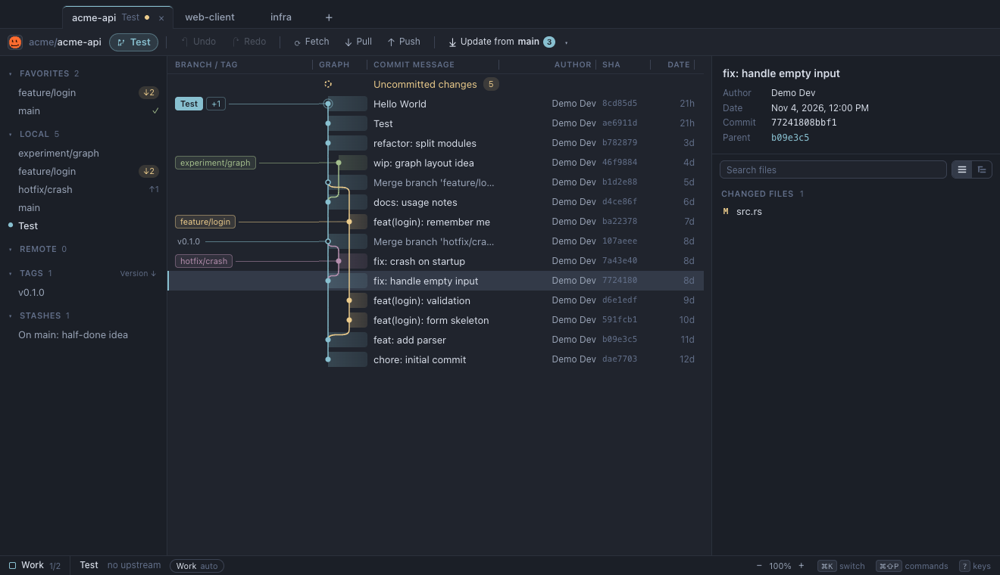
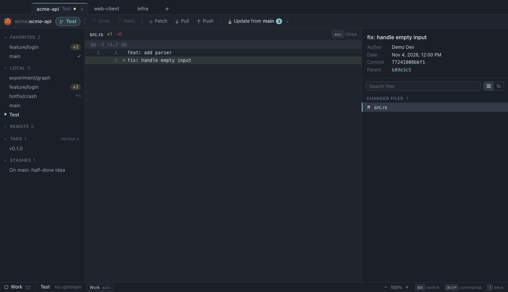
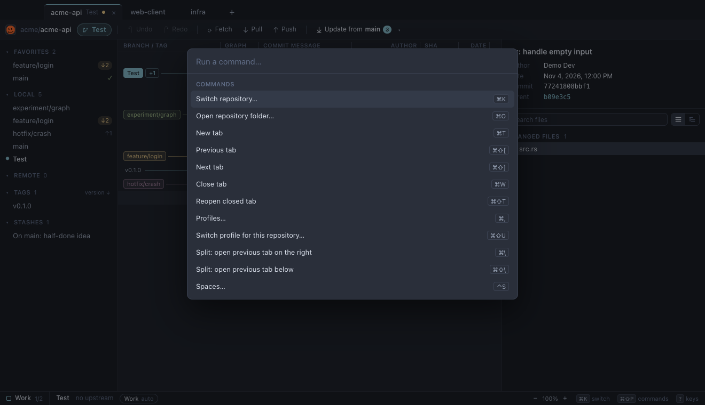

<p align="center">
  
</p>
<h1 align="center">Alfie</h1>
<p align="center">A minimal, keyboard-first Git desktop app for macOS.</p>
<p align="center">
  <a href="LICENSE">MIT license</a> · <a href="#install-the-desktop-app">Install</a> · <a href="CONTRIBUTING.md">Contribute</a>
</p>

Alfie puts your working tree, commit graph, branches, and diffs in one window.
It runs Git locally through a Rust backend, with a Svelte 5 interface and Tauri 2.
Named after a tri-colour mini Aussie.

- Stage files, hunks, or selected lines and write commits.
- Work with branches, tags, stashes, merges, and rebases.
- Switching branches automatically stashes staged, unstaged, and untracked changes.
  Select a stash to preview its files and diffs, then use Apply or Pop to restore it.
  Stashes remain saved until you pop or delete them; returning to a branch does not restore them automatically.
  Submodule checkouts and edits stay in place when switching branches; stash edits inside each submodule separately.
  Discarding a submodule restores its recorded commit and refuses to overwrite local work inside it.
- Fetch, pull, and push using your Git credentials or SSH profiles.
- Organize repositories into tabs and spaces, with split views.
- Navigate with keyboard shortcuts and a command palette.
- Open a branch's GitHub pull request from its `PR #…` link in the sidebar or toolbar.

## Screenshots

Captured from the browser demo with synthetic repository data. The desktop app
uses the same interface, with native macOS window controls.

### Commit graph and repository navigation



### File diffs



### Command palette



## Supported operating systems

| Platform | Current status |
| --- | --- |
| macOS on Apple Silicon | Primary development and build target |
| macOS on Intel | Not verified; no tested Intel build is provided |
| Windows and Linux | Not currently supported or tested |

The current build has been checked on macOS 26 with Apple Silicon. Older macOS
versions have not been verified. Tauri's platform support alone does not mean
Alfie has been tested on those platforms.

## Install the desktop app

### Download for macOS

Download [Alfie 0.2.0 for Apple Silicon](https://github.com/cpugkhe/alfie/releases/download/v0.2.0/Alfie_0.2.0_aarch64.dmg)
from [GitHub Releases](https://github.com/cpugkhe/alfie/releases/latest).

1. Open the downloaded `.dmg` file.
2. Drag **Alfie** to **Applications**.
3. Eject the disk image and open **Alfie** from Applications.

This build is for Apple Silicon Macs. Git must be installed and available on
your `PATH`. Node.js, pnpm, and Rust are not needed to run the downloaded app.
If Git is missing, run `xcode-select --install` to install Apple's command-line tools.

The app is ad-hoc signed and is **not notarized by Apple**. If macOS blocks it,
follow Apple's [instructions for opening an app from an unidentified developer](https://support.apple.com/en-us/102445).
Only use **System Settings → Privacy & Security → Open Anyway** if you trust
the download. There is no automatic update channel; download future versions
from GitHub Releases.

### Build from source

To build the app yourself, follow the steps below on your Mac.

### 1. Install the prerequisites

Install these tools before building:

- [Xcode Command Line Tools](https://v2.tauri.app/start/prerequisites/#macos).
- [Rust](https://www.rust-lang.org/tools/install), with the stable toolchain.
- [Node.js](https://nodejs.org/) 22.18 or later, using a supported LTS release.
- [pnpm](https://pnpm.io/installation) 11.
- [Git](https://git-scm.com/downloads), available on your `PATH`.

To install Apple's command-line tools, run:

```sh
xcode-select --install
```

If pnpm is not installed, run:

```sh
npm install --global pnpm@11
```

Check that the tools are available:

```sh
git --version
rustc --version
cargo --version
node --version
pnpm --version
```

### 2. Clone and build

```sh
git clone https://github.com/cpugkhe/alfie.git
cd alfie
pnpm install --frozen-lockfile
pnpm tauri build --bundles app
```

The first build downloads Rust dependencies and compiles the desktop app.
It produces `src-tauri/target/release/bundle/macos/Alfie.app`, built for your
Mac's native architecture.

### 3. Install and launch

Quit an existing copy of Alfie before replacing it. Copy the app to your user
Applications folder and open it:

```sh
mkdir -p "$HOME/Applications"
cp -R src-tauri/target/release/bundle/macos/Alfie.app "$HOME/Applications/"
open "$HOME/Applications/Alfie.app"
```

You can also open the generated app directly in Finder. After installation,
Alfie runs as a desktop app without a development server. Git must remain
available on your `PATH`.

Local builds are not notarized by this project. For distribution to other Macs,
see Tauri's [macOS signing guide](https://v2.tauri.app/distribute/sign/macos/).

## Use Alfie

1. Launch Alfie and choose **Open folder**, or press **⌘O**.
2. Select an existing Git repository.
3. Open **Uncommitted changes** to inspect diffs, stage changes, and write a commit.
4. Use **Fetch**, **Pull**, and **Push** to synchronize with your remote.

Alfie uses your existing Git configuration and credentials. Optional profiles
let you select a Git identity and an SSH key per repository. Profiles store the
key's path, not the private key itself. Unlock passphrase-protected keys through
your SSH agent or macOS Keychain before use.

PR links are optional and currently support open PRs (including drafts) on
github.com. Click **Connect GitHub** in the status bar. Alfie detects an existing
GitHub CLI login, guides installation if needed, and shows a one-time code for
browser sign-in. Click **Copy code & open GitHub**, enter the code, and authorize
GitHub CLI. The panel confirms your account and refreshes PR links automatically.
Closing the panel cancels a pending sign-in.

Choose **Account for this repository** to use a saved GitHub CLI account, or
**Add account** to sign in to another. The choice is saved per repository,
separately from commit/SSH profiles. **GitHub CLI default** follows the CLI's
current authentication. Choosing an account leaves the CLI default unchanged;
adding one restores the previous default after sign-in.

You can also install [GitHub CLI](https://cli.github.com/) and run `gh auth login`
in Terminal. Alfie reuses that login, separately from Git credentials and SSH
profiles, and finds `gh` on the app's `PATH` or in standard macOS Homebrew locations.
Alfie checks configured GitHub remotes,
including fork PRs when the base repository is also a remote (usually `upstream`).
Metadata refreshes on repository activity or app focus, at most once per minute.
If `gh`, authentication, or the network is unavailable, PR links are hidden and
local Git operations continue normally.

| Shortcut | Action |
| --- | --- |
| **⌘O** | Open a repository folder |
| **⌘K** | Jump to a repository |
| **⌘⇧P** | Open the command palette |
| **?** | Show the shortcut list |

Discard, hard reset, and history edits can remove work. Read the confirmation
before approving a destructive operation. See [security and privacy notes](SECURITY.md)
for repository trust, avatar requests, and known dependency limitations.

## Develop locally

After installing the prerequisites and dependencies, run:

```sh
pnpm tauri dev
```

This launches the desktop app with live frontend updates. To preview the
interface in a browser with synthetic demo data, run `pnpm dev` and open
`http://127.0.0.1:1420`. The browser preview does not operate on real repositories.

Run the checks from the repository root:

```sh
pnpm test
pnpm check
cargo test --manifest-path src-tauri/Cargo.toml --locked
pnpm build
```

## Contribute

Bug reports, documentation fixes, and focused pull requests are welcome.
Read [CONTRIBUTING.md](CONTRIBUTING.md) for setup, validation, and pull request guidelines.
For substantial features or platform ports, open an issue first to discuss scope.

## License

Alfie is available under the [MIT license](LICENSE). Dependencies retain their
own licenses.
